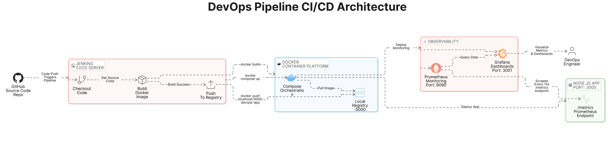

# DevOps Pipeline: Automated CI/CD & Observability Stack

A comprehensive DevOps ecosystem demonstrating the full software development lifecycle. This project features a containerized Node.js application, an automated Jenkins CI/CD pipeline, and a full observability stack using Prometheus and Grafana.

## Architecture Features
- **CI/CD Automation**: Automated Jenkins pipeline that handles code checkout, Docker image building, and pushing to a local registry.
- **Observability**: Real-time application monitoring with a dedicated `/metrics` endpoint, Prometheus scraping, and Grafana visualization.
- **Container Orchestration**: Multi-container environment managed via Docker Compose, ensuring seamless interaction between the app and infrastructure.
- **Secure Architecture**: Implementation of a private local Docker registry for secure image storage.

## Project Structure
- **app/**: Node.js source code, dependencies, and Dockerfile for the application.
- **jenkins/**: Declarative Jenkinsfile defining the CI/CD pipeline stages.
- **monitoring/**: Configuration files for Prometheus (scraping targets) and Grafana (dashboards).
- **scripts/**: Shell scripts for environment maintenance and automation.
- **docker-compose.yml**: The orchestration layer connecting the App, Monitoring, and Registry services.

## Access URLs
| Service | URL |
| :---: | :---: |
| **Sample App** | `localhost:3000` | 
| **Prometheus** | `localhost:9090` |
| **Grafana** | `localhost:3001` |
| **Local Registry** | `localhost:5000` |

## Getting Started

### Prereguisites
- Docker & Docker Compose installed.
- Jenkins instance configured with Docker pipeline plugins.

### Installation & Deployment
1. Clone the repository: 
   `git clone https://github.com/Nawaf1208/DevOps-Pipeline.git`

2. Spin up the infrastructure:
   `docker compose up -d`

3. Verify monitoring:
   Access Grafana at `http://localhost:3001` and ensure the Prometheus data source is connected to `http://prometheus:9090` 

### Cleanup
To stop the services and clean up unused Docker resources (networks, volumes, and dangling images), run the provided utility script: `chmod +x scripts/cleanup.sh` & `./scripts/cleanup.sh`

## Pipeline Stages
1. **Checkout**: Pulls the latest source code from GitHub.
2. **Build**: Build a lightweight `node:18-alpine` Docker image.
3. **Push**: Tags and pushes the image to the local private registry.